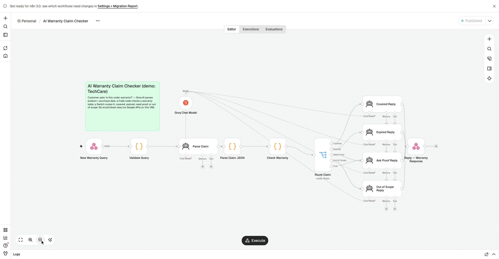

# AI Warranty Claim Checker

An n8n workflow that answers "is this under warranty?" in seconds. It reads the customer's message, works out the product and purchase date, checks a fixed warranty table, and replies with the verdict and the next step — no receipt digging, no customer waiting a day for a yes or no.

## The problem

Every warranty question waits while the owner finds the receipt, checks the purchase date, looks up the warranty period and types a reply. The customer waits. The competitor answers first.

## How it works

1. **New Warranty Query** — a webhook receives the query (name, free-text message).
2. **Validate Query** — a Code node checks the message is non-empty and longer than 5 characters.
3. **Parse Claim** — an AI agent (Groq) extracts the product and purchase date as one-line JSON.
4. **Parse Claim JSON** — a Code node parses the agent's JSON text, with a regex-salvage fallback that recovers the product and date from truncated output.
5. **Check Warranty** — a Code node checks the claim deterministically against a fixed warranty table (see below).
6. **Route Claim** — a Switch routes it: Covered / Expired / Need Proof / Out of Scope.
7. **Covered Reply** — an AI agent confirms the cover and the next step: bring the product and proof of purchase, free repair or replacement.
8. **Expired Reply** — an AI agent gives a polite no and offers a paid repair with a free check.
9. **Ask Proof Reply** — an AI agent asks for one thing: the purchase date or a receipt/invoice photo — no verdict guessed.
10. **Out of Scope Reply** — an AI agent gives a polite no and lists what the shop covers.
11. **Reply — Warranty Response** — returns the verdict, product, months since purchase, warranty months and reply.

One Groq Chat Model (gpt-oss-120b) is shared by all five AI agents.

Warranty table (demo business TechCare, electronics shop): Smartphone 12 months · Laptop 24 · TV 24 · Washing Machine 24 · Fridge 24 · Smartwatch 12 · Headphones 6 · Accessories (charger/cable) 3. Covered if months since purchase are within the warranty; expired if over; need proof if there is no usable purchase date; out of scope if the product isn't in the table.

## Live test results

Tested live on the production webhook — 5 out of 5, first attempt each, all HTTP 200.

| Test | Claim | Result |
|------|-------|--------|
| A | Ayesha: smartphone bought 2026-08-23, screen not working | **Covered** — 3 months since purchase, 12-month warranty |
| B | Bilal: laptop bought 2024-05-23, battery died | **Expired** — 30 months since purchase, 24-month warranty |
| C | Sara: headphones stopped working, no purchase date | **Need proof** — asked for the date or a receipt photo, no verdict guessed |
| D | Omar: "is my car still under warranty?" | **Out of scope** — polite no, lists what the shop covers |
| E | Zain: charger bought 2026-09-23, not working | **Covered** — 2 months since purchase, 3-month warranty |

## Try it

1. Import `warranty-checker.json` into n8n.
2. Add a Groq credential and connect it to the Groq Chat Model node (model `openai/gpt-oss-120b`).
3. Activate the workflow and POST a JSON query to `/webhook/warranty` with `name` and `message`.
4. The verdict, product, months since purchase, warranty months and reply come back in the response.

## Limits

- Demo shop only (TechCare is not a real shop). No email is sent and no sheet row is written — the reply comes back in the webhook response in seconds. (On the self-hosted setup this ran on, the VM egress proxy blocks gmail.googleapis.com and sheets.googleapis.com, so Gmail/Sheets nodes can't work there.)

## Built with

n8n · Groq (gpt-oss-120b) · JavaScript (Code nodes)

Part of a daily series building one real automation for small businesses, every day.
